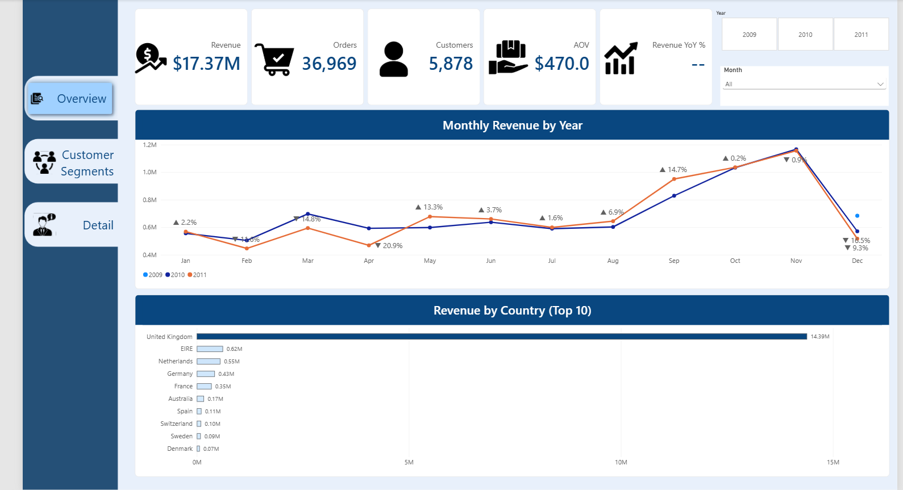
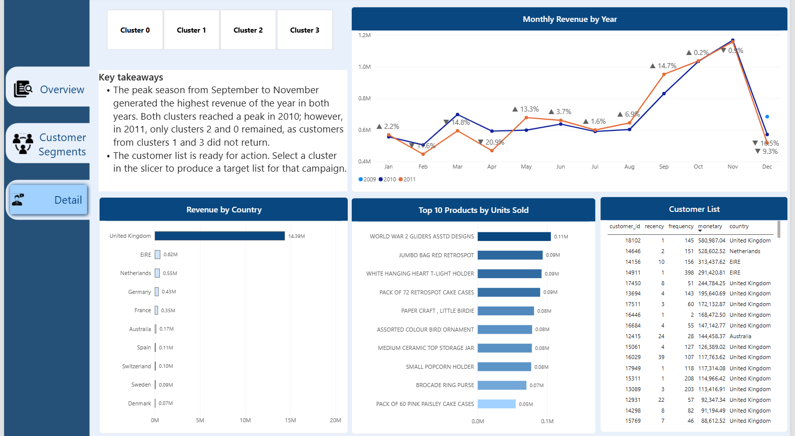

# Phân khúc khách hàng bán lẻ trực tuyến bằng RFM + K-Means

> Từ dữ liệu giao dịch thô đến dashboard Power BI: phân cụm khách hàng, rút ra insight và đề xuất hành động kinh doanh.

**Công nghệ:** Python (pandas, scikit-learn) · PostgreSQL · Star Schema · Power BI (DAX)

---

## 1. Bài toán kinh doanh

Doanh nghiệp bán lẻ trực tuyến (Vương quốc Anh) có hàng nghìn khách hàng nhưng chưa biết:

1. Nhóm khách nào tạo ra phần lớn doanh thu?
2. Nhóm nào đang có nguy cơ rời bỏ nhưng vẫn đáng để giữ lại?
3. Nhóm nào có tiềm năng tăng trưởng?
4. Nên chạy chiến dịch gì, vào thời điểm nào, với sản phẩm nào?

**Mục tiêu:** chia khách hàng thành các cụm có hành vi tương đồng để mỗi cụm có một chiến lược chăm sóc riêng.

## 2. Dữ liệu

- Nguồn: bộ dữ liệu **Online Retail II** (giao dịch 12/2009 – 12/2011). https://www.kaggle.com/datasets/mashlyn/online-retail-ii-uci
- Sau làm sạch: **779.425 dòng giao dịch**, **5.878 khách hàng**, tổng doanh thu **≈ 17,37 triệu**.

**Lưu ý chất lượng dữ liệu**

| Vấn đề | Cách xử lý / ảnh hưởng |
|---|---|
| ~22,8% dòng gốc thiếu Customer ID | Loại bỏ (không thể gán cho khách nào) |
| Một số đơn bị lặp | Loại bỏ dánh đếm đôi giá trị |
| Bỏ `Quantity <= 0` hoặc `Price <= 0` | Điều chỉnh kho, hàng tặng, lỗi nhập liệu. Bước này cũng loại toàn bộ hóa đơn hủy (mã bắt đầu bằng "C"), vì các dòng hủy luôn có `Quantity` âm |

## 3. Kiến trúc giải pháp

```
Notebook (Python)            PostgreSQL                         Power BI
┌──────────────────┐   ┌────────────────────────┐   ┌─────────────────────┐
│ Làm sạch dữ liệu │   │ schema staging         │   │ Import mode         │
│ Tính RFM         │──▶│  transactions_clean    │   │ Star Schema         │
│ K-Means          │   │  customer_rfm_clusters │   │ Measures DAX        │
│                  │   ├────────────────────────┤──▶│ 3 trang dashboard   │
└──────────────────┘   │ schema dw (Star Schema)│   └─────────────────────┘
                       │  fact_sales            │
                       │  dim_customer          │
                       │  dim_product           │
                       │  dim_date              │
                       └────────────────────────┘
```

**Quyết định thiết kế**

- **ELT:** notebook ghi dữ liệu thô vào `staging`, SQL tách thành `dw`.
- **Mô hình:** 1 bảng fact và 3 bảng dim.


### Mô hình dữ liệu (Star Schema)

| Bảng | Khóa | Cột chính |
|---|---|---|
| `fact_sales` | — | invoice_no, invoice_date, customer_id, stock_code, country, quantity, unit_price |
| `dim_customer` | customer_id | recency, frequency, monetary, cluster_id |
| `dim_product` | stock_code | description |
| `dim_date` | date | year, quarter, month_number, month_name, year_month, day_of_week, day_name, is_weekend |

Quan hệ: `fact_sales` nối với `dim_customer` qua `customer_id`, với `dim_product` qua `stock_code`, với `dim_date` qua `invoice_date = date`. Cả ba đều là khóa ngoại trong PostgreSQL.


## 4. Phương pháp phân cụm

1. Tính **RFM** theo khách hàng với mốc thời gian 2011-12-10:
   - **R**ecency: số ngày kể từ lần mua gần nhất
   - **F**requency: số đơn hàng
   - **M**onetary: tổng chi tiêu
2. Biến đổi **Box-Cox** để giảm lệch, rồi **StandardScaler**.
3. **K-Means với k = 4**.


## 5. Kết quả: 4 cụm khách hàng

| Cụm | Tên gọi | Recency (ngày) | Frequency (đơn) | Monetary | Vai trò |
|:--:|---|--:|--:|--:|---|
| 2 | VIP đang hoạt động | 32 | 15,6 | 8.358 | Cốt lõi doanh thu |
| 3 | Khách cũ giá trị | 287 | 4,4 | 1.564 | Mục tiêu kéo quay lại |
| 0 | Khách mới / tiềm năng | 40 | 2,4 | 665 | Cơ hội tăng trưởng |
| 1 | Rời bỏ | 431 | 1,2 | 284 | Giá trị thấp |

## 6. Key insight

1. **Cụm 2 chiếm 28% số khách nhưng tạo ~80% doanh thu.** Mua gần đây, rất thường xuyên. Giữ chân nhóm này là ưu tiên số một.
2. **Cụm 3 là cơ hội kéo quay lại tốt nhất.** Đã lâu không mua (~287 ngày) nhưng từng chi khá và mua 4–5 đơn.
3. **Cụm 0 là cơ hội tăng trưởng.** Còn đang mua nhưng mới 2–3 đơn. Mục tiêu là đưa lên cụm 2.
4. **Cụm 1 giá trị thấp.** ~431 ngày không mua, hầu như chỉ mua một lần, chiếm 27% số khách nhưng chỉ ~2,6% doanh thu.
5. **27,6% khách chỉ mua một lần**, khoảng một phần tư khách chưa từng quay lại.
6. **Thị trường:** Anh chiếm ~83% doanh thu. 

### Yếu tố mùa vụ (tháng 9–11)

- **Năm 2010 cả bốn cụm** đều có đỉnh. **Năm 2011 chỉ còn cụm 2 và 0** (cụm 2: 83%, cụm 0: 15% doanh thu tháng 9–11), vì khách cụm 1 và 3 đã không quay lại.
- Sản phẩm bán chạy mùa này: Regency Cakestand 3 Tier, White Hanging Heart T-Light Holder, Jumbo Bag Red Retrospot, Paper Chain Kit 50's Christmas, Assorted Colour Bird Ornament.


## 7. Đề xuất hành động

**Lịch chung:** tháng 8 chuẩn bị tồn kho và danh sách khách → tháng 9 mở chiến dịch → tháng 10–11 cao điểm → tháng 12–1 chăm sóc sau mùa.

| Cụm | Mục tiêu | Hành động | Thời điểm | KPI gợi ý |
|:--:|---|---|---|---|
| 2 | Giữ chân, tăng sản lượng | Liên hệ trực tiếp, đặt hàng trước, ưu tiên tồn kho các mã chủ lực, chính sách giá cho khách sỉ | Tháng 8–9 | Tỷ lệ giữ chân, doanh thu/khách |
| 3 | Kéo quay lại | Nhắc đúng mặt hàng họ từng mua mùa trước, báo hàng mới về, ưu đãi có thời hạn | Tháng 8–9 (trước đỉnh) | Tỷ lệ quay lại, doanh thu thu hồi |
| 0 | Mua lần 2–3, nâng lên cụm 2 | Gợi ý sản phẩm kèm, ưu đãi đơn thứ hai, nhắc lại sau 30–60 ngày | Tháng 10–11 | Tỷ lệ mua lần 2, tần suất |
| 1 | Kích hoạt chi phí thấp | Một email đầu tháng 9 cho nhóm chi cao nhất, không đầu tư thêm | Tháng 9 | Tỷ lệ phản hồi |

## 8. Dashboard Power BI

| Trang | Nội dung | Trả lời câu hỏi |
|---|---|---|
| 1. Overview | KPI doanh thu, số khách, doanh thu theo thời gian (kèm YoY), theo quốc gia | Tình hình kinh doanh chung ra sao? |
| 2. Customer Segments | Quy mô và doanh thu theo cụm, scatter Recency–Frequency–Monetary | Các cụm khác nhau thế nào? |
| 3. Cluster Detail | Chọn từng cụm: sản phẩm bán chạy, danh sách khách, xu hướng | Chạy chiến dịch với ai và sản phẩm nào? |







